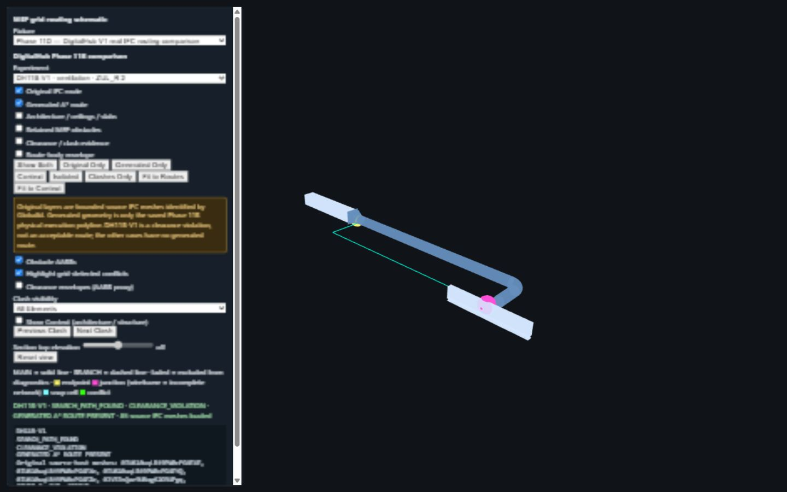
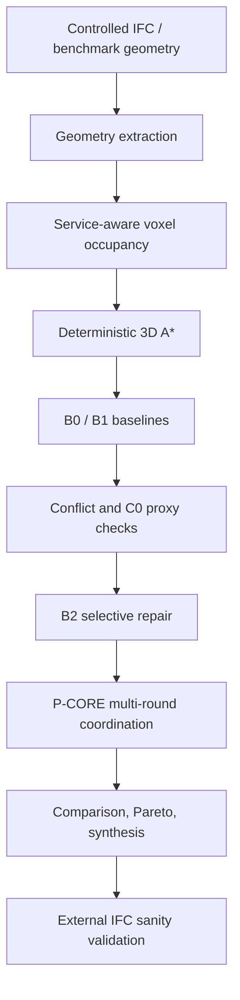

# Construction360 MEP Routing Research

An auditable research prototype for deterministic MEP routing in controlled
synthetic and bounded real-IFC geometry. The research asks how route
completeness, clash reduction, endpoint semantics, and physical clearance
interact; it is not production coordination, fabrication, or code-compliance
software.

> **Current status:** the frozen synthetic benchmark is reproducible. Real-IFC
> work has source-mesh, endpoint, clearance, and viewer evidence, but Phase
> 11B produced one search path with a clearance violation and four no-path
> outcomes—zero physically acceptable routes out of five requests.

## Current research map

- **Synthetic benchmark:** B0 independently routes all 292 requests but leaves
  conflicts; B1 demonstrates the completeness/conflict trade-off; B2 and
  P-CORE reduce but do not eliminate the conflict burden.
- **Real IFC:** Medical-Dental work investigates source geometry, units,
  registration and native-port readiness. DigitalHub V1 supplies five bounded
  Phase 11B requests. Original authored MEP geometry is a reference
  installation, not an optimal-route ground truth.
- **Viewer:** run `python -m http.server 8765 --directory viewer`, then open
  `http://127.0.0.1:8765/index.html?fixture=digitalhub_phase11b_fixture.json`.
  It overlays source IFC MEP meshes and the saved generated A* polyline, while
  retaining failed states and clearance evidence.



*DH11B-V1 viewer evidence: rendered geometry is not proof of collision freedom;
the recorded result remains `CLEARANCE_VIOLATION`.*

## Historical Phase 9A status

`src.endpoints` defines typed immutable world-coordinate endpoints, connector profiles, endpoint flow semantics, and authoritative connection requests. Endpoint provenance distinguishes `BENCHMARK_SYNTHETIC`, `IFC_DISTRIBUTION_PORT`, `EXPORT_CONNECTOR`, `MANUAL`, and `INFERRED`; unknown orientation and flow remain explicit rather than fabricated. The benchmark adapter converts existing source, egress, and terminal anchors without changing their generated identities, coordinates, or serialized research inputs.

Phase 9A does not extract IFC ports, change the legacy benchmark router, plan topology, perform orientation-aware routing, or replace the research validator. Those remain later gated phases.

## Current research baseline

The immutable baseline was migrated on 2026-10-01 from [`serhataydilek/mep-research`](https://github.com/serhataydilek/mep-research) at `72a511f55d249f41f289bcb8f0212213cbb277d1` (`research-v1.0`) into [`Construction360/smartsites_hvac_reserach`](https://github.com/Construction360/smartsites_hvac_reserach). Its history is retained on `main`; later work is recorded in the research registry.



The fixed benchmark has four architectural scenarios, three demand profiles, five systems, 12 scenario-demand cases, 292 requested routes, and 0.1 m voxels. Inputs and outputs are deterministic.

| Method | Successful | Hard conflicts | Clearance violations | Length (m) | Bends | Vertical (m) |
|---|---:|---:|---:|---:|---:|---:|
| B0 | 292/292 | 1,256 | 1,257 | 3,507.7 | 572 | 0.0 |
| B1 | 144/292 | 0 | 0 | 2,516.6 | 603 | 12.8 |
| B2 | 292/292 | 936 | 941 | 3,962.3 | 803 | 11.6 |
| P-CORE-SEED | 292/292 | 1,020 | 1,209 | 3,515.1 | 620 | 7.4 |
| P-CORE-6C2B | 292/292 | 747 | 926 | 3,662.9 | 804 | 17.7 |

`B1` proves that reservation can produce zero observed inter-system conflicts among completed routes, but it leaves 148 requests unrouted. `P-CORE-6C2B` retains 292/292 routes while reducing conflict burden; its 747 hard-conflicting route pairs mean it is not a clash-free production result.

## Product objective

The future router must accept only layouts with zero hard conflicts, zero clearance violations, zero forbidden structural intersections, valid penetrations, and satisfied system constraints. A partial result is honest: accepted routes must be valid and every unresolved demand must receive a structured reason.


The proposed stack is IFC ingestion → authoritative ports → topology planning → semantic routing space → constrained A* → PBS-inspired coordination → neighborhood rerouting → continuous geometry → independent validator → IFC and 3D output. It is architecture, not implemented behavior.

## Run the baseline

Validated runtime: Python 3.14.3 with pinned `ifcopenshell==0.8.5` and `pytest==9.1.1`.

```powershell
python -m pip install -r requirements.txt
python -m pytest
python -m src.final_synthesis --scenarios experiments/scenarios --demands experiments/demands --systems config/mep_systems.json --constraints config/constructability.json --coordinator config/coordinator.json
```

Generated outputs remain ignored by Git. See the original baseline commands in [BUILDSPEC.md](BUILDSPEC.md).

## Documentation

- [Research chronology](docs/research/RESEARCH_CHRONOLOGY.md), [experiment registry](docs/research/EXPERIMENT_REGISTRY.csv), [failures and lessons](docs/research/FAILURES_AND_LESSONS.md), and [current research status](docs/research/RESEARCH_STATUS.md)
- [DigitalHub dataset and license attribution](docs/IFC_TEST_DATASETS_README.md) and [Phase 11B real-IFC clearance benchmark](docs/PHASE_11B_REAL_IFC_CLEARANCE_BENCHMARK.md)
- [Master research and productization report](docs/MASTER_RESEARCH_AND_PRODUCTIZATION_REPORT.md)
- [Current research baseline](docs/CURRENT_RESEARCH_BASELINE.md)
- [Known limitations](docs/KNOWN_LIMITATIONS.md)
- [Target architecture](docs/TARGET_ARCHITECTURE.md)
- [Algorithm design](docs/ALGORITHM_DESIGN.md)
- [IFC and BIM integration](docs/IFC_AND_BIM_INTEGRATION.md)
- [Validation strategy](docs/VALIDATION_STRATEGY.md)
- [Implementation roadmap](docs/IMPLEMENTATION_ROADMAP.md)
- [Decision log](docs/DECISION_LOG.md) and [references](docs/REFERENCES.md)

## Repository structure

`src/` is the frozen research implementation; `tests/` contains 20 test modules (170 tests at release validation); `config/` and `experiments/` contain deterministic benchmark inputs; `validation/` records external IFC provenance; `docs/` defines the next-stage design. No production router, IFC writer, or viewer is implemented in this migration.
