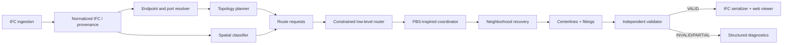
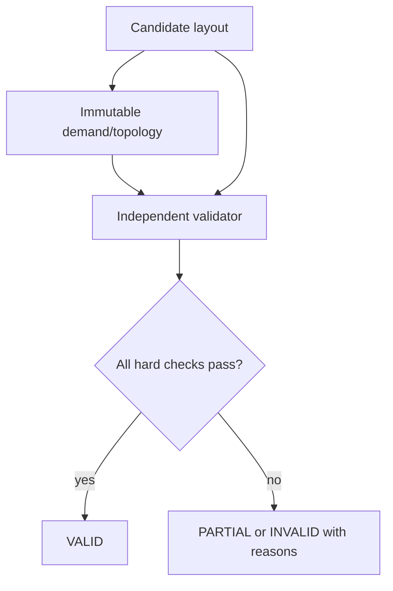

# Target Architecture

## Boundary and data flow

IFC ingestion, routing, validation, serialization, and visualization are separate components. The router may propose geometry; it cannot certify itself.

## Authoritative inputs

Normalize units, placements, storey scope, element provenance, and geometry before routing. Endpoint resolution priority is: (1) `IfcDistributionPort`; (2) application/export connector metadata; (3) manually supplied connector; (4) inferred connector marked `INFERRED`. Each endpoint records IFC GUID/source, coordinate frame, orientation, flow direction, system, confidence, and evidence. Missing authoritative endpoints are a reported readiness failure, never silently fabricated facts.

Topology planning converts endpoint sets into explicit source/main/branch/terminal graph candidates. Shared geometry has an owning topology component and compatible capacity/profile metadata. It may choose header locations and branch points, but it must preserve demanded connectivity independently of routed geometry.

## Spatial and penetration models

Classify cells or continuous regions as `ROUTABLE`, `ROUTABLE_WITH_PENETRATION`, `EXISTING_OPENING`, `STRUCTURAL_FORBIDDEN`, `ARCHITECTURAL_FORBIDDEN`, `RESERVED`, or `ACCESS_EXCLUSION`. Architecture and structure must retain element GUIDs and storey context. Use coarse corridor planning then local resolution, with exact/conservative geometry checks at boundaries.

Penetration planning evaluates existing openings first, then permitted candidate openings. A candidate records host element, host GUID, entry/exit, required sleeve/opening profile, clearance, policy status, and structural approval requirement. Routing cannot tunnel through a wall or slab absent a valid penetration decision.

## Coordination and output

The low-level state includes position, direction, profile, clearance policy, service constraints, and—when necessary—slope. It treats accepted routes and reservations as hard exclusions. PBS-inspired high-level coordination resolves a detected conflict by branching on partial priority constraints and replanning only affected routes; CBS remains a correctness/reference alternative for smaller subproblems. If coordination stalls, rip up a conflict neighborhood and reroute it while all outside accepted geometry remains hard blocked.

After validation, convert topology-owned centerlines to swept circular pipe, rectangular duct/tray, fittings, reducers, tees, penetrations, and equipment connections. The eventual viewer consumes validated output only, with layers for architecture, structure, each MEP system, clearance envelopes, penetrations, corridors, and conflict debug.

